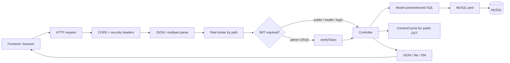

# Brito School Backend — Complete Technical Documentation

| Field | Value |
|---|---|
| Product | Brito School Management System backend |
| Document | Complete technical documentation |
| Version | 1.0.0 |
| Date | 17 November 2026 |
| Scope | `server/` implementation only |
| Runtime verified | Node.js v24.19.0, npm 11.17.0 |
| Database verified | MySQL 8.0.46, database `brito_school` |
| Application package | `brito-school-backend@1.0.0` |
| Express | `express@^5.3.0` (installed 5.3.0 in this project) |

These results describe the tested local environment and do not constitute a guaranteed production capacity or SLA.

---

## Table of contents

1. [Part 1 — Application architecture](#part-1--application-architecture)
2. [Part 2 — Complete API documentation](#part-2--complete-api-documentation)
3. [Part 3 — Rate limiting](#part-3--rate-limiting)
4. [Part 4 — Database connection and MySQL capacity](#part-4--database-connection-and-mysql-capacity)
5. [Part 5 — Simultaneous users and concurrency](#part-5--simultaneous-users-and-concurrency)
6. [Part 6 — API response times](#part-6--api-response-times)
7. [Part 7 — Caching system](#part-7--caching-system)
8. [Part 8 — Authentication and security](#part-8--authentication-and-security)
9. [Part 9 — Application functionality by module](#part-9--application-functionality-by-module)
10. [Part 10 — File upload and storage](#part-10--file-upload-and-storage)
11. [Part 11 — Performance and load-test results](#part-11--performance-and-load-test-results)
12. [Part 12 — Known limitations and future scalability](#part-12--known-limitations-and-future-scalability)
13. [Part 13 — Final technical summary](#part-13--final-technical-summary)
14. [Glossary](#glossary)

---

## Part 1 — Application architecture

### 1.1 Overview

The Brito School backend is a single Node.js process that exposes a JSON REST API for one school website. It serves:

- Unauthenticated public content (announcements, calendars, galleries, daily Thirukkural).
- A single administrator account (login, profile, dashboard, content CRUD, file uploads).
- Health probes for process liveness and MySQL readiness.
- Static files under `/uploads` and `/docs`.

There is **no public user registration**, **no multi-role permission system**, and **no background job scheduler** (cron). The only recurring in-process timers are rate-limiter map cleanup (every 60 seconds, `unref`’d) and coalesced health ping / disk metric caches.

### 1.2 Verified technology stack

| Layer | Verified value |
|---|---|
| Runtime | Node.js v24.19.0 |
| Package manager | npm 11.17.0 |
| HTTP framework | Express 5.3.0 |
| Database driver | `mysql2` promise pool |
| Database | MySQL 8.0.46, schema `brito_school`, charset `utf8mb4` |
| Auth | JSON Web Tokens (`jsonwebtoken`), bcrypt cost 10 |
| Uploads | `multer` disk storage |
| Email (password reset) | `nodemailer` Gmail transport |
| Compression | Custom gzip for JSON ≥ 8192 bytes (skipped on public GET, `/uploads`, and health GETs) |

### 1.3 Express architecture

`server.js` constructs one Express `app`:

1. Disable `X-Powered-By`.
2. Optional `trust proxy` when `TRUST_PROXY` is `true` or `1`.
3. Security headers middleware.
4. CORS allow-list.
5. `express.json` / `urlencoded` with **2 MB** body limit.
6. Conditional gzip wrapper.
7. Static `/uploads` (7-day cache) and `/docs`.
8. Health routes (`/health`, `/health/live`, `/health/ready`).
9. Rate limiters, then routers.
10. JSON 404 handler.
11. Central error handler (busy pool → 503, invalid JSON → 400, otherwise 500).
12. HTTP listen with backlog default **2048**, `keepAliveTimeout` 65000 ms, `headersTimeout` 66000 ms, `requestTimeout` 120000 ms.
13. Graceful shutdown on `SIGINT` / `SIGTERM` / uncaught exception: close HTTP server, then `pool.end()`.

Default listen port is `process.env.PORT` or **5000**.

### 1.4 Folder structure (backend)

```
server/
  server.js                         # process entry, middleware, health, mount points
  config/db.js                      # mysql2 pool
  config/jwt.js                     # JWT secret loader
  admin/middleware/authMiddleware.js
  admin/middleware/rateLimiter.js
  admin/utils/cache.js              # in-memory ContentCache
  admin/utils/validate.js           # integer / pagination parsers
  admin/utils/files.js              # path-safe unlink under uploads/
  admin/routes/                     # Express routers
  admin/controller/                 # HTTP handlers
  admin/model/                      # parameterized SQL
  admin/seed/seedAdmin.js           # one-time admin seed (not an HTTP API)
  public/routes/publicRoutes.js
  public/controller/publicController.js
  uploads/galleries/                # gallery files
  uploads/calendars/                # calendar files
  tests/                            # automated tests
  scripts/                          # load tests, measure, index migrate
```

### 1.5 How a frontend request travels



Typical public GET:

Frontend → Express → CORS → skip gzip → `publicReadLimiter` (if `/api/public/...`) or `generalLimiter` (if aliased `/api/...`) → public controller → `contentCache.load` → MySQL on miss → JSON with ETag / Cache-Control.

Typical admin write:

Frontend → Express → CORS → gzip wrapper → `generalLimiter` → `verifyToken` (Bearer JWT + `admins` row lookup) → controller validation → model INSERT/UPDATE/DELETE → `contentCache.invalidate(namespace)` → JSON.

### 1.6 Routes, controllers, models, middleware

| Concern | Implementation |
|---|---|
| Routes | `admin/routes/*.js`, `public/routes/publicRoutes.js`, health in `server.js` |
| Controllers | `admin/controller/*.js`, `public/controller/publicController.js` |
| Models | `admin/model/*.js` using `pool.execute` / `pool.query` with `?` placeholders |
| Auth middleware | `verifyToken` |
| Rate limit | `authLimiter`, `publicReadLimiter`, `generalLimiter` |
| Uploads | multer + magic-byte validators on gallery/calendar routes |
| Cache | `ContentCache` used only by public GET handlers |

### 1.7 Authentication architecture

- One administrator row in `admins`.
- Login issues a JWT signed with `JWT_SECRET`, payload `{ id, email }`, **`expiresIn: "1d"`**.
- Protected routes require `Authorization: Bearer <token>`.
- After signature verification, `findAdminById(payload.id)` must return a row. Missing, non-positive, or unknown IDs yield HTTP 401.
- Password hashing uses bcrypt (compare on login; hash cost **10** on reset and seed).

### 1.8 Database connection architecture

A process-wide `mysql2` pool (`config/db.js`). Controllers never open a new pool. Dedicated connections (`pool.getConnection()`) are used only for:

- Startup ping in `StartServer`.
- Gallery create (capacity lock + transaction).
- Daily Thirukkural publish (lock + `FOR UPDATE` transaction).

Connections are released in `finally` blocks.

### 1.9 Error-handling architecture

- Controllers catch errors and return `{ success: false, message }` with 400/401/404/409/500 as appropriate.
- Unmatched routes: 404 `"Endpoint not found"`.
- Central handler: MySQL connection/queue exhaustion → 503 `"Server is busy. Please try again shortly."`; JSON parse errors → 400 `"Invalid JSON payload"`; other errors → 500 (generic message in production).
- `unhandledRejection` is logged. `uncaughtException` triggers graceful shutdown.

### 1.10 Caching architecture

In-memory `ContentCache` (TTL **5 minutes**, max **200** entries) for public content JSON. Not Redis. Not shared across Node processes. See Part 7.

### 1.11 File upload architecture

Multer writes to `server/uploads/galleries` and `server/uploads/calendars`. Express serves `/uploads` statically. See Part 10.

### 1.12 Background or scheduled processes

| Mechanism | Purpose |
|---|---|
| Rate-limiter `setInterval` 60s | Delete expired IP records |
| Health DB ping cache 1s / 250ms | Coalesce `SELECT 1` |
| Disk metrics cache 30s | Coalesce `statfs` on uploads |
| OTP expiry | Stored in MySQL (`DATE_ADD(NOW(), INTERVAL 2 MINUTE)`), not a timer |

No cron, queue worker, or scheduled Thirukkural rotation outside request handling.

---

## Part 2 — Complete API documentation

**Endpoint inventory (verified in route files and `server.js`):**

- 3 health endpoints
- 5 public GET handlers, also mounted as 5 aliases under `/api` (10 public URLs, 5 handlers)
- 1 login
- 2 password-reset endpoints
- 4 announcement admin endpoints
- 3 calendar admin endpoints (no calendar UPDATE API)
- 4 gallery admin endpoints
- 4 Thirukkural admin endpoints
- 3 profile endpoints (`DELETE /profile` is not implemented; it 404s)
- 1 dashboard endpoint

**Total unique HTTP handlers: 30.**  
**Total public URL paths including aliases: 35 API paths + static `/uploads` and `/docs`.**

There is **no** dedicated analytics router beyond the dashboard. There is **no** public registration API.

**Common headers**

| Header | When |
|---|---|
| `Content-Type: application/json` | JSON bodies |
| `Authorization: Bearer <jwt>` | All `/api/admin/*` except login, forgot-password, reset-password |
| `If-None-Match: <etag>` | Optional on public GET for HTTP 304 |
| `Origin` | Browser CORS |

**Common success/error envelope**

```json
{ "success": true }
```

```json
{ "success": false, "message": "Server Error" }
```

Pagination (optional query): `limit` (positive integer, capped at 500; galleries public cap 30) and `page` (default 1). Omitting `limit` returns all rows for that resource.

---

### 2.1 Authentication APIs

#### POST `/api/admin/login`

| Field | Value |
|---|---|
| Purpose | Authenticate the administrator and issue a JWT |
| Auth | None |
| Rate limiter | `authLimiter` — 30 / 15 minutes / IP |
| Headers | `Content-Type: application/json` |
| Body | `{ "email": "string", "password": "string" }` |
| Validation | Both fields required |
| Database | `SELECT id, email, password, mobile_number FROM admins WHERE email = ? LIMIT 1` then bcrypt compare |
| Cache | None |

Successful response (token value omitted):

```json
{
  "success": true,
  "message": "Admin logged in successfully!",
  "token": "<jwt>",
  "admin": { "id": 1, "email": "<admin email>", "mobile_number": "<optional>" }
}
```

Errors:

| Status | Condition | Example message |
|---:|---|---|
| 400 | Missing email or password | Email and password are required |
| 401 | Unknown email or wrong password | Invalid email or password |
| 429 | Auth limiter exceeded | Too many authentication attempts. Please try again later. |
| 500 | Unexpected error | Server Error |

Login always runs bcrypt (dummy hash if the email is unknown) so timing does not reveal whether the email exists.

---

### 2.2 Public APIs

Public handlers do **not** require JWT. They set:

- `Cache-Control: public, max-age=15, stale-while-revalidate=60`
- `ETag` (MD5 of JSON string, quoted)
- `Last-Modified`
- `Vary: Accept-Encoding`

**Rate limiter note:** `/api/public/*` uses **10,000 / 15 minutes**. The same handlers mounted at `/api/announcements`, `/api/calendars`, `/api/galleries`, `/api/thirukkural`, `/api/thirukkural/daily` go through **`generalLimiter` (1,000 / 15 minutes)** because they are registered after `app.use("/api", generalLimiter)`.

#### GET `/api/public/announcements`  
Alias: `GET /api/announcements`

| Field | Value |
|---|---|
| Purpose | List announcements, newest first |
| Auth | None |
| Query | Optional `limit`, `page` |
| DB | `SELECT id, title, content, category, created_at, updated_at FROM announcements ORDER BY created_at DESC` |
| Cache | Namespace `announcements`, key `announcements:{limit\|all}:{page}` |

Success:

```json
{
  "success": true,
  "count": 1,
  "announcements": [
    {
      "id": 1,
      "title": "Sports Day",
      "content": "...",
      "category": "General",
      "created_at": "2026-11-17T00:00:00.000Z",
      "updated_at": "2026-11-17T00:00:00.000Z"
    }
  ]
}
```

Empty database: `{ "success": true, "count": 0, "announcements": [] }`.  
304 when `If-None-Match` equals ETag.  
500 on database failure.

#### GET `/api/public/calendars`  
Alias: `GET /api/calendars`

Same pattern; namespace `calendars`; rows include `file_path` and `file_url`.

#### GET `/api/public/galleries`  
Alias: `GET /api/galleries`

Public limit is `min(requested limit, 30)`, default `{ limit: 30, offset: 0 }` when pagination is omitted. Response includes `max_capacity: 30`.

#### GET `/api/public/thirukkural`  
Alias: `GET /api/thirukkural`

Returns the **current daily kural** as a one-element list (`getDailyKural`: latest `created_at, id`), not the full table. Cache key `thirukkural:current`.

```json
{ "success": true, "count": 1, "kurals": [ { "id": 1, "kural_number": 1, "tamil_text": "...", "english_meaning": "...", "explanation": null } ] }
```

#### GET `/api/public/thirukkural/daily`  
Alias: `GET /api/thirukkural/daily`

```json
{ "success": true, "kural": { "id": 1, "kural_number": 1, "tamil_text": "...", "english_meaning": "...", "explanation": null } }
```

or `"kural": null` when the table is empty.

---

### 2.3 Admin APIs

All of the following require `Authorization: Bearer <jwt>` except where noted. Rate limiter: **`generalLimiter` 1,000 / 15 minutes / IP**.

#### Announcements

| Method | Endpoint | Purpose |
|---|---|---|
| GET | `/api/admin/announcements` | List (optional pagination) |
| POST | `/api/admin/announcements` | Create |
| PUT | `/api/admin/announcements?id=<id>` | Update |
| DELETE | `/api/admin/announcements?id=<id>` | Delete |

POST body: `{ "title", "content", "category?" }`. Title and content required. Category defaults to `"General"`.  
PUT: missing/invalid `id` → 400; unknown id → 404. Omitted fields keep existing values.  
Writes invalidate cache namespace `announcements`.

POST success:

```json
{
  "success": true,
  "message": "Announcement created successfully!",
  "announcement": { "id": 12, "title": "Notice", "content": "...", "category": "General" }
}
```

#### Calendars (no PUT)

| Method | Endpoint | Purpose |
|---|---|---|
| GET | `/api/admin/calendars` | List |
| POST | `/api/admin/calendars` | Multipart upload |
| DELETE | `/api/admin/calendars?id=<id>` | Delete row and file |

POST `multipart/form-data`: `title` (required), `description` (optional), file field (any name). File required. Invalidates `calendars`.

#### Galleries

| Method | Endpoint | Purpose |
|---|---|---|
| GET | `/api/admin/galleries` | List + `total`, `max_capacity`, `remaining` |
| POST | `/api/admin/galleries` | Upload image |
| PUT | `/api/admin/galleries?id=<id>` | Update metadata and/or image |
| DELETE | `/api/admin/galleries?id=<id>` | Delete |

POST requires title + image. Capacity **30** rows → HTTP **409**. Invalidates `galleries`.

#### Thirukkural

| Method | Endpoint | Purpose |
|---|---|---|
| GET | `/api/admin/thirukkural` | Full list ordered by `kural_number ASC` |
| POST | `/api/admin/thirukkural` | Publish daily kural (create/update/replace) |
| PUT | `/api/admin/thirukkural?id=<id>` | Edit by id |
| DELETE | `/api/admin/thirukkural?id=<id>` | Delete |

POST body: `kural_number`, `tamil_text`, `english_meaning` required; `explanation` optional. Duplicate `kural_number` → 400 `ER_DUP_ENTRY`. Invalidates `thirukkural`.

#### Profile

| Method | Endpoint | Purpose |
|---|---|---|
| GET | `/api/admin/profile` | Read logged-in admin profile (no password) |
| POST | `/api/admin/profile` | Update requiring `full_name` and `alternative_email` |
| PUT | `/api/admin/profile` | Partial update of profile fields |

Password, OTP, and email login fields are not updated by these handlers. `DELETE /api/admin/profile` is not registered (404).

---

### 2.4 Dashboard and analytics APIs

There is one analytics-style endpoint:

#### GET `/api/admin/dashboard`

| Field | Value |
|---|---|
| Auth | JWT |
| Rate limiter | general 1,000 / 15 minutes |
| DB | Two queries in parallel: combined counts + latest rows; `GROUP BY category` on announcements |
| Cache | None |

Success shape:

```json
{
  "success": true,
  "dashboard": {
    "announcements": { "total": 0, "byCategory": [], "latest": null },
    "calendars": { "total": 0, "latest": null },
    "galleries": { "total": 0, "latest": null },
    "thirukkural": { "total": 0, "latest": null },
    "generatedAt": "2026-11-17T00:00:00.000Z"
  }
}
```

---

### 2.5 Gallery APIs

Documented in 2.2 (public) and 2.3 (admin). Public list is cached; admin writes invalidate `galleries`. Files are served at `/uploads/galleries/<filename>` without JWT.

---

### 2.6 Calendar APIs

Documented in 2.2 and 2.3. There is no admin calendar update endpoint. Files at `/uploads/calendars/<filename>`.

---

### 2.7 Thirukkural APIs

Documented in 2.2 and 2.3. Public list and daily endpoints both call `getDailyKural()` (latest row), not the full catalogue. Admin GET lists all rows.

---

### 2.8 Health and monitoring APIs

No JWT. **No rate limiter** in `server.js`. Gzip skipped for these GET paths.

#### GET `/health`

200 when DB ping is `CONNECTED`, else 503. Body includes `status` (`UP` / `DEGRADED`), `timestamp`, `uptimeSeconds`, `database.status` / `latencyMs`, `connectionPool` (`totalConnections`, `freeConnections`, `waitingRequests`), `storage` (may be `null`), `memory` (`rssMb`, `heapUsedMb`, `heapTotalMb`).

Ping uses `SELECT 1 AS ping`, cached **1000 ms** on success and **250 ms** on failure, with single-flight.

#### GET `/health/live`

Always 200 `{ status: "UP", timestamp, uptimeSeconds }` — does not query MySQL.

#### GET `/health/ready`

200 `{ status: "UP", database: { status: "CONNECTED" } }` or 503 `{ status: "DEGRADED", database: { status } }`.

---

### 2.9 Password reset APIs

#### POST `/api/admin/forgot-password`

| Field | Value |
|---|---|
| Auth | None |
| Rate limiter | auth 30 / 15 minutes |
| Body | `{ "email": "string" }` |
| Validation | Required; must match `/^[^\s@]+@[^\s@]+\.[^\s@]+$/` |

If the email exists, a 6-digit OTP is stored (`otp_code`, `otp_expires_at = NOW() + 2 minutes`) and emailed via Gmail. SMTP failure clears the OTP. Unknown emails still return the same 200.

Success (always, including many internal errors):

```json
{
  "success": true,
  "message": "If an account exists for this email, a password reset OTP has been sent."
}
```

400 if email missing or invalid format.

#### POST `/api/admin/reset-password`

Body: `{ email, otp, newPassword, confirmPassword }`. All required. Passwords must match. `newPassword.length >= 6`. Invalid/unknown OTP → 400 `"Invalid OTP code."`. Expired OTP → 400. Success hashes password with bcrypt cost 10 and clears OTP.

---

## Part 3 — Rate limiting

### 3.1 What it means

Rate limiting counts **HTTP requests per client IP per 15-minute window**, not “number of human users” and not “number of registered accounts”. One browser refreshing a page and one script looping both consume the same request budget.

Verified configuration in `admin/middleware/rateLimiter.js`:

| Category | `max` | `windowMs` | Applied to |
|---|---:|---:|---|
| Authentication | **30** | **15 × 60 × 1000 ms** | `/api/admin/login`, `/forgot-password`, `/reset-password` |
| Public GET under `/api/public` | **10,000** | 15 minutes | `/api/public/*` |
| Other `/api` routes | **1,000** | 15 minutes | Admin APIs and **aliased** public URLs `/api/announcements` etc. |

These previously reported values **match the source**.

Disable switch: when `NODE_ENV === "test"` **and** `DISABLE_RATE_LIMIT === "true"`, limiters call `next()` immediately. Automated functional tests use this. Rate-limit security tests do **not**. Load scripts also disable limiters so they measure application throughput, not the limiter.

### 3.2 How the 15-minute window works

Per IP the limiter stores `{ count, resetTime }` where `resetTime = now + windowMs`. The first request starts the window. Until `now > resetTime`, every request increments `count`. After expiry, the next request starts a new window at count 1.

Cleanup: every 60 seconds expired keys are deleted. If more than **20,000** IP keys exist, the entire map is cleared (safety valve).

### 3.3 Per IP, in-memory, not shared across processes

- Key = `req.ip || req.socket.remoteAddress || "unknown"`.
- Storage = a JavaScript `Map` in that Node process.
- Multiple Node processes each have their own counters (effective limit ≈ `max × process count`).
- Behind a reverse proxy, `TRUST_PROXY` must be enabled or many clients share one IP (`x-forwarded-for` ignored).

### 3.4 HTTP 429 behavior and headers

When `count > max`:

```http
HTTP/1.1 429
X-RateLimit-Limit: 30
X-RateLimit-Remaining: 0
X-RateLimit-Reset: 1731820000
Retry-After: 847
Content-Type: application/json

{"success":false,"message":"Too many authentication attempts. Please try again later.","retryAfterSeconds":847}
```

Allowed requests still receive `X-RateLimit-Limit`, `X-RateLimit-Remaining`, and `X-RateLimit-Reset`.

### 3.5 Realistic examples

- A parent opening the public site 20 times in 15 minutes: well under 10,000.
- A login brute-force script: blocked after 30 POSTs from that IP.
- Admin dashboard polling every second: 900 requests / 15 minutes — under 1,000; twice per second would 429.
- Using `/api/announcements` instead of `/api/public/announcements` consumes the **1,000** budget, not 10,000.

---

## Part 4 — Database connection and MySQL capacity

### 4.1 Pool configuration (`config/db.js`)

| Setting | Source | Default if env unset |
|---|---|---|
| `connectionLimit` | `DB_CONNECTION_LIMIT` | **25** |
| `queueLimit` | `DB_QUEUE_LIMIT` | **500** |
| `maxIdle` | `DB_MAX_IDLE` | **15** |
| `idleTimeout` | `DB_IDLE_TIMEOUT` | **60000** ms |
| `waitForConnections` | code | **true** |
| `enableKeepAlive` | code | **true** |
| `keepAliveInitialDelay` | code | **10000** ms |
| `connectTimeout` | code | **10000** ms |
| `charset` | code | `utf8mb4` |
| `database` | `DB_NAME` | `brito_school` |
| `port` | `DB_PORT` | `3306` |

Previously reported 25 / 500 / keep-alive **match the code defaults**. Credentials are read from environment variables and are **not** documented here.

### 4.2 How the pool works

The pool keeps up to 25 live TCP sessions to MySQL. A query borrows a free connection, runs SQL, and returns it. Idle connections above `maxIdle` can be closed after `idleTimeout`. Keep-alive reduces dead-connection stalls.

**Maximum 25 connections** means at most 25 SQL statements execute on MySQL from this process at the same time.

**Queue limit 500** means if all 25 are busy, up to 500 additional acquire requests wait. The 501st waiting acquire is rejected (mysql2 queue-limit error → HTTP 503 via the central handler).

**When all 25 are busy:** further queries wait (`waitForConnections: true`) until a connection is released or the queue is full.

**Release:** `connection.release()` after locks, or implicit release when `pool.query` / `pool.execute` finish. Gallery and daily-kural paths always `release()` in `finally`. Startup health check releases after `SELECT`.

**Leak prevention:** `finally` release; graceful `pool.end()` on shutdown; no per-request `createConnection`.

**`getConnection()` operations:** gallery create (GET_LOCK `brito_gallery_capacity`, transaction, INSERT); Thirukkural `publishDailyKural` (GET_LOCK `brito_thirukkural_daily`, `SELECT ... FOR UPDATE`, insert/update/delete); server listen callback ping.

**When MySQL is unavailable:** pool queries throw; controllers return 500; health/ready return 503 `UNREACHABLE` / `DEGRADED`. The process still listens.

### 4.3 Tables (verified `SHOW CREATE TABLE` on 17 November 2026)

Engine InnoDB, charset `utf8mb4`, collation `utf8mb4_0900_ai_ci`. **No foreign keys.**

#### `admins`

| Column | Notes |
|---|---|
| `id` | PK, AUTO_INCREMENT |
| `email` | UNIQUE, NOT NULL |
| `password` | bcrypt hash |
| `mobile_number`, `full_name`, `alternative_email`, `phone_primary`, `phone_secondary`, `School_location` | Profile fields |
| `otp_code`, `otp_expires_at` | Reset OTP (2 minutes) |
| `created_at`, `updated_at` | timestamps |

#### `announcements`

PK `id`. Index **`idx_announcements_created_at` (`created_at` DESC)**. Columns: title, content, category default `General`.

#### `calendars`

PK `id`. Index **`idx_calendars_created_at` (`created_at` DESC)**. `file_path` and `file_url` NOT NULL.

#### `galleries`

PK `id`. Index **`idx_galleries_created_at` (`created_at` DESC)**. `image_path` NOT NULL. Application-enforced max 30 rows.

#### `thirukkural`

PK `id`. UNIQUE **`kural_number`**. Index **`idx_thirukkural_created_at_id` (`created_at` DESC, `id` DESC)**.

### 4.4 Query patterns

- List pages: `ORDER BY created_at DESC` (kurals admin: `kural_number ASC`).
- Lookups: `WHERE id = ? LIMIT 1`.
- Login: `WHERE email = ?`.
- Dashboard: scalar subqueries for counts and latest ids, plus category GROUP BY.
- Daily kural public: `ORDER BY created_at DESC, id DESC LIMIT 1`.
- Pagination LIMIT/OFFSET only after `parsePositiveInt` (digits only, cap 500).

Cache does not store MySQL rows separately from the JSON payload; invalidation is application-level (Part 7).

On very small tables MySQL may still choose a full scan (`EXPLAIN` type ALL) even with indexes present. That is an optimizer behavior, not a missing-index bug.

---

## Part 5 — Simultaneous users and concurrency

### 5.1 Terms

| Term | Meaning in this project |
|---|---|
| Total registered users | Rows that can log in. The product model is **one administrator**. Public visitors are not registered. |
| Active users | People using the site in a business period (day/week). Not measured by the backend. |
| Concurrent users | People with the site open at the same moment. Not equal to load-test workers. |
| Concurrent workers | Independent HTTP clients in `load_test.js` / `load_test_public.js` that keep a request in flight. |
| Simultaneous API requests | Requests being processed at one instant (bounded by Node event loop + pool of 25). |
| Concurrent HTTP connections | TCP connections accepted (listen backlog default 2048). |
| RPS | Completed requests divided by wall-clock seconds. |

### 5.2 Latest mixed public load (17 November 2026)

Script: `npm run test:load:public` against an ephemeral local server, **rate limiting disabled**, ~95% public GET + ~5% admin writes.

| Concurrent workers | Requests | RPS | Read avg | Read P95 | Write P95 | Errors | Pool peak total/wait | Event-loop P95/max |
|---:|---:|---:|---:|---:|---:|---:|---|---|
| 50 | 1000 | 2225.0 | 20.39 ms | 39.31 ms | 124.08 ms | 0% | 8 / 0 | 29.57 / 29.77 ms |
| 100 | 1500 | 3836.1 | 24.65 ms | 36.76 ms | 58.79 ms | 0% | 8 / 0 | 27.53 / 28.56 ms |
| 200 | 2000 | 3680.9 | 46.39 ms | 81.82 ms | 340.14 ms | 0% | 25 / 23 | 38.31 / 39.94 ms |
| 300 | 2500 | 3604.9 | 73.79 ms | 114.93 ms | 261.75 ms | 0% | 25 / 15 | 38.50 / 39.94 ms |
| 500 | 3000 | 2209.7 | 187.79 ms | 453.28 ms | 719.80 ms | 0% | 25 / 20 | 65.80 / 165.81 ms |

### 5.3 Earlier mixed-load snapshot (previously reported)

These figures were **not reproduced** on the 17 November 2026 rerun. They remain a historical local snapshot:

| Concurrent workers | RPS | Read average | Read P95 | Write P95 | Errors |
|---:|---:|---:|---:|---:|---:|
| 50 | 2,965.8 | 15.41 ms | 35.15 ms | 74.90 ms | 0% |
| 100 | 5,114.8 | 18.69 ms | 28.83 ms | 41.42 ms | 0% |
| 200 | 4,868.5 | 39.14 ms | 63.43 ms | 92.23 ms | 0% |
| 300 | 4,857.3 | 58.20 ms | 81.80 ms | 120.57 ms | 0% |
| 500 | 4,221.9 | 108.03 ms | 162.86 ms | 284.93 ms | 0% |

Latency at 500 workers varies substantially between runs (this run read P95 **453 ms** vs earlier **163 ms**). Both completed with **0% errors**.

### 5.4 Answers to capacity questions

- **How many concurrent workers were successfully tested?** 50, 100, 200, 300, and **500**, all with 0% errors in the latest mixed-load run.
- **Does 500 workers mean 500 registered users?** No. Workers are synthetic HTTP clients. The application has a single admin login identity plus anonymous public readers.
- **Does 500 workers mean 500 people can use the app continuously without delay?** No. At 500 workers, latest read P95 was **453 ms** and write P95 **720 ms** — still successful, but slower than low concurrency.
- **How many actual simultaneous users can the application support?** Not a verified production number.
- **What influences simultaneous-user capacity?** Think time between clicks, cache hit ratio, payload size, MySQL 25-connection cap, single Node process, CPU, disk for uploads, reverse-proxy timeouts, and rate limits (which were off during load tests).
- **What happens when concurrency increases?** RPS plateaus then drops; latency and event-loop delay rise; the pool hits 25 and waiting requests appear from ~200 workers in this run.
- **When does response time become noticeably higher?** In this run, from **200 workers** (read P95 ~82 ms vs ~37 ms at 100). At **500**, delay is clearly user-visible for mixed write traffic.

**500 concurrent load-test workers were tested successfully in the reported local environment. The exact production simultaneous-user capacity has not yet been established.**

**Planning estimate only (not verified capacity):** if a typical public visitor generates about 2–4 API calls per minute and most reads hit cache, hundreds of casual browsers can coexist with the 10,000 / 15-minute public limiter and the 25-connection pool. That arithmetic is **not** a measurement and **must not** be treated as an SLA.

---

## Part 6 — API response times

### 6.1 Sequential measurements (latest, 17 November 2026)

`npm run test:measure` — one request at a time against a local ephemeral server, rate limiting disabled. **These are not concurrent-load numbers.**

| Endpoint | Samples | Average | P95 | P99 | Err % |
|---|---:|---:|---:|---:|---:|
| GET `/health` | 40 | 14.69 ms | 16.62 ms | 29.89 ms | 0% |
| GET `/health/live` | 40 | 13.58 ms | 16.26 ms | 16.38 ms | 0% |
| GET `/health/ready` | 40 | 15.22 ms | 16.87 ms | 17.31 ms | 0% |
| Public announcements | 40 | 15.44 ms | 17.27 ms | 17.85 ms | 0% |
| Public calendars | 40 | 13.59 ms | 16.35 ms | 17.07 ms | 0% |
| Public galleries | 40 | 14.85 ms | 16.61 ms | 18.52 ms | 0% |
| Public Thirukkural | 40 | 14.05 ms | 16.38 ms | 17.59 ms | 0% |
| Daily Thirukkural | 40 | 12.80 ms | 16.89 ms | 17.34 ms | 0% |
| Admin announcements | 30 | 14.00 ms | 17.47 ms | 18.16 ms | 0% |
| Admin dashboard | 30 | 13.89 ms | 17.46 ms | 20.74 ms | 0% |
| Admin profile | 30 | 15.59 ms | 16.78 ms | 17.32 ms | 0% |
| Admin Thirukkural | 30 | 14.43 ms | 16.59 ms | 40.33 ms | 0% |
| Invalid admin login | 10 | 65.45 ms | 77.41 ms | 77.41 ms | 0% |

A previously supplied sequential table (health 14.17 ms, login 62.31 ms, etc.) is the same class of test on an earlier run. Latest verified numbers are the table above.

### 6.2 Definitions

- **Average:** arithmetic mean of sample latencies.
- **P95 / P99:** 95% / 99% of samples were faster than this value.
- **RPS:** throughput under that scenario, not a promise for production.

### 6.3 Cache vs login

Public sequential times include warm cache after the first sample in the batch. Cache **miss** adds one MySQL round trip (typically a few extra milliseconds locally). Cache **hit** returns the pre-stringified JSON and may 304.

Invalid login is slower because **bcrypt.compare** is intentionally CPU-expensive (cost 10), including against a dummy hash for unknown emails.

### 6.4 Under concurrency

See Part 5 and 11: averages move from ~15 ms sequential to tens or hundreds of milliseconds at 200–500 workers.

---

## Part 7 — Caching system

Implemented in `admin/utils/cache.js`, used by `publicController.js`.

| Setting | Verified value |
|---|---|
| Default TTL | **5 minutes** (`5 * 60 * 1000`) |
| Max entries | **200** (oldest key evicted) |
| Browser Cache-Control | **`public, max-age=15, stale-while-revalidate=60`** |
| ETag | `"md5(jsonStr)"` |
| 304 | If `If-None-Match` equals ETag; body empty; Content-Type omitted |
| Process sharing | **No** — each Node process has its own Map |

### 7.1 Single-flight

`load(key, namespace, fetchFn)`:

1. Return cached entry if present and unexpired.
2. Else join an in-flight Promise keyed by `namespace::key::generation`.
3. First caller runs `fetchFn` (MySQL).
4. `set` stores the result only if `expectedGeneration` still matches.

Concurrent public GETs for the same key share **one** database fill.

### 7.2 Generation / invalidation

`invalidate(namespace)` increments that namespace’s generation and deletes matching store entries.

| Admin operation | Namespace invalidated |
|---|---|
| Announcement create/update/delete | `announcements` |
| Calendar create/delete | `calendars` |
| Gallery create/update/delete | `galleries` |
| Thirukkural create/update/delete | `thirukkural` |

Profile, dashboard, login, and password reset do **not** invalidate public cache.

### 7.3 Admin write during an in-flight public GET

If generation changes before `set`, `set` returns `null` and the stale payload is returned **once** as an ephemeral entry (not stored). The next GET loads the new generation from MySQL. Automated tests cover this race.

Cache is **not** shared across processes: invalidation on instance A does not clear instance B (browser `max-age=15` still bounds public JSON).

---

## Part 8 — Authentication and security

### Implemented

| Feature | Behavior |
|---|---|
| Registration | **Not** an HTTP API. Admin is created via `admin/seed/seedAdmin.js` only. |
| Login | POST `/api/admin/login`, bcrypt, dummy hash for unknown emails |
| JWT | HS256-style `jwt.sign` / `jwt.verify`, 1-day expiry, payload `{id, email}` |
| Admin authorization | Any valid token whose `id` exists in `admins` may call admin APIs (single admin model; no roles) |
| Forgot / reset | Generic 200 on forgot; 6-digit OTP, 2-minute expiry; bcrypt 10 on reset |
| SQL injection protection | `?` placeholders via `mysql2` `execute`/`query`. Pagination integers parsed with `/^\d+$/` |
| Input validation | Required fields, email regex, password length ≥ 6, positive integer ids |
| File validation | Extension + MIME + magic bytes + size `< 30 MB` |
| CORS | `CORS_ORIGIN` comma list; if unset, localhost only in non-production; **production with unset list rejects browser Origins**; missing Origin allowed |
| Security headers | `X-Content-Type-Options: nosniff`, `X-Frame-Options: SAMEORIGIN`, `X-XSS-Protection: 0`, `Referrer-Policy: strict-origin-when-cross-origin`; `X-Powered-By` disabled |
| Rate limiting | Part 3 |
| Error handling | Generic 500 in production; no stack to client |
| Sensitive data | Passwords never returned; profile SELECT omits password and OTP; JWT secret from env (production requires length ≥ 16) |

### Not implemented / not claimed

- Refresh tokens, token revocation list, cookie/httpOnly session store
- Multi-factor authentication beyond email OTP for password reset
- Role-based access control
- Helmet as a package (headers are set manually)
- HTTPS termination (left to the reverse proxy / host)
- Account lockout beyond IP rate limits
- CSRF tokens (API uses Bearer JWT, not cookies)
- Deleting the live admin row was **not** tested (would lock out the only account)

JWT secret values and live tokens are never logged in this document.

---

## Part 9 — Application functionality by module

### 9.1 Process / HTTP core (`server.js`)

Boots Express, CORS, compression, static files, health, limiters, routers, 404/500, listen, shutdown.

### 9.2 Public content

APIs: five GET handlers (+ aliases). Tables: announcements, calendars, galleries, thirukkural. Auth: none. Cache: yes. Interacts with admin writes via invalidation.

### 9.3 Admin authentication

API: login. Table: `admins`. Issues JWT. Interacts with all protected modules.

### 9.4 Password reset

APIs: forgot/reset. Table: `admins` OTP columns. Email via nodemailer. Auth limiter.

### 9.5 Announcements

Full CRUD. Category default General. Dashboard reads counts/categories.

### 9.6 Calendars

List, upload, delete. Files on disk. No update API.

### 9.7 Galleries

CRUD with 30-image cap, MySQL named lock, unreferenced file delete. Public list capped at 30.

### 9.8 Thirukkural

Admin list is full catalogue. POST publishes “today’s” kural in Asia/Kolkata: same-day update in place; otherwise replace previous rows so typically one active row. Unique `kural_number`. Public APIs expose only the latest row.

### 9.9 Profile

GET/POST/PUT on `admins` non-secret columns. Tied to JWT `req.admin.id`.

### 9.10 Dashboard

Read-only aggregation across four content tables.

### 9.11 Health

Process and MySQL probes; pool and memory metrics.

### 9.12 Static files and docs

`/uploads` immutable 7-day cache; `/docs` for Postman collection.

### 9.13 Seed (non-HTTP)

`seedAdmin.js` truncates `admins` and inserts id=1. Operational script, not a route. Running it destroys existing admin rows — not part of runtime request flow.

---

## Part 10 — File upload and storage

### 10.1 Gallery images

| Rule | Verified value |
|---|---|
| Directory | `server/uploads/galleries` |
| URL | `/uploads/galleries/gallery-<timestamp>-<random>.<ext>` |
| Extensions | `.jpg` `.jpeg` `.png` `.gif` `.webp` |
| MIME | must start with `image/` |
| Magic bytes | JPEG `FF D8 FF`, PNG `89 50 4E 47`, GIF `GIF`, WebP `RIFF....WEBP` |
| Size | Multer `fileSize`: **30 × 1024 × 1024 − 1** bytes (must be **below 30 MB**) |
| Count | Max **30** gallery rows; extra POST → 409 |
| Multiple files | `upload.any()`; first file used as `req.file` |
| Missing file | 400 title + image required |

### 10.2 Calendar files

| Rule | Verified value |
|---|---|
| Directory | `server/uploads/calendars` |
| URL | `/uploads/calendars/calendar-<timestamp>-<random>.<ext>` |
| Extensions | `.pdf` `.jpg` `.jpeg` `.png` `.gif` `.webp` |
| PDF magic | `%PDF` only when extension/MIME claims PDF |
| Size | **below 30 MB** (same `30*1024*1024 - 1`) |
| Missing file/title | 400 |

Failed validation unlinks the temp file. Delete handlers unlink via `files.js`, which refuses paths outside `server/uploads`.

Invalid type / empty / oversized / fake magic → HTTP 400 with specific messages (`Only image files...`, `Invalid file content: ...`, `Image size must be below 30 MB...`).

---

## Part 11 — Performance and load-test results

**Environment:** local Windows development machine, Node v24.19.0, MySQL 8.0.46 on localhost, single Node process, `DISABLE_RATE_LIMIT=true` inside load scripts, ephemeral high port. This is **not** production hosting.

### 11.1 Admin / health load (`npm run test:load`, 17 November 2026)

| Scenario | Concurrency | Requests | RPS | Avg | P95 | P99 | Errors |
|---|---:|---:|---:|---:|---:|---:|---:|
| Admin announcements baseline | 1 | 100 | 70.6 | 14.17 ms | 17.83 ms | 36.11 ms | 0% |
| Admin announcements | 10 | 500 | 1153.2 | 8.63 ms | 13.02 ms | 30.59 ms | 0% |
| Admin announcements | 50 | 1000 | 1994.8 | 24.83 ms | 35.87 ms | 56.24 ms | 0% |
| Admin announcements | 100 | 2000 | 2074.6 | 47.85 ms | 59.37 ms | 69.51 ms | 0% |
| Admin Thirukkural | 50 | 1000 | 2343.0 | 21.18 ms | 26.90 ms | 29.90 ms | 0% |
| Admin dashboard | 50 | 1000 | 1582.3 | 31.37 ms | 50.26 ms | 55.56 ms | 0% |
| Health probe | 100 | 2000 | 6085.5 | 16.19 ms | 23.80 ms | 35.07 ms | 0% |

### 11.2 Mixed public GET + admin write

See Part 5 latest table. At 500 workers: 3000 requests, 0% errors, pool **25 / 20 waiting**, event-loop max **165.81 ms**, heap delta negative after GC.

Cache-hit vs miss is not a separate named scenario in the load script; mixed traffic includes writes that invalidate cache, so many reads are misses or recently filled.

**These results describe the tested local environment and do not constitute a guaranteed production capacity or SLA.**

---

## Part 12 — Known limitations and future scalability

Do not treat the following as implementation tasks for this document.

| Limitation | Meaning | Immediate issue? | When it matters | Possible future direction |
|---|---|---|---|---|
| In-memory cache per process | Each Node instance has its own JSON cache | No for a single process | Multiple instances / rolling deploys | Redis or HTTP cache at CDN |
| In-memory rate limit per process | Limits multiply with processes; reset on restart | No for one process | Horizontal scale or many NATed IPs | Redis / gateway limiter |
| Single Node.js process | One event loop; CPU-bound bcrypt blocks it | No at current school traffic | High login abuse or large JSON | More instances behind a proxy |
| P95 rises with concurrency | Users wait longer under load | Not at sequential ~15 ms | ≥200 synthetic workers locally | Scale MySQL/app, cache, CDN |
| Health ping ≤ 1 s stale | `/health` may show connected for up to 1s after DB drop | Acceptable for probes | Fast failover orchestration | Shorter TTL if required |
| Tiny-table table scans | Optimizer may ignore indexes on 0–1 rows | No | Large row counts — indexes already exist | Re-check EXPLAIN when data grows |
| Public aliases use 1,000 limiter | `/api/announcements` is stricter than `/api/public/announcements` | Only if clients use aliases heavily | High traffic on alias URLs | Point clients at `/api/public` |
| 25 MySQL connections | Hard concurrency cap per process | Waiting seen at 200+ workers in mixed load | Write-heavy spikes | Raise pool only with MySQL `max_connections` headroom |
| 2 MB JSON body limit | Larger posts rejected | No for current forms | Huge paste content | Increase only if required |
| OTP emailed in plaintext SMTP | Standard email risk | Operational | Compromised mailbox | Shorter TTL already 2 minutes |
| No JWT revocation | Stolen token valid until expiry (1 day) or admin row deleted | Acceptable for single admin | Stolen laptop | Rotate `JWT_SECRET` / shorten expiry |
| Load tests disable rate limits | Benchmarks are not production traffic shape | Documentation only | Production has 30/10k/1k caps | Capacity plan with limiters on |

---

## Part 13 — Final technical summary

| Topic | Verified summary |
|---|---|
| Stack | Node.js 24.19.0, Express 5.3.0, mysql2, MySQL 8.0.46, JWT, bcrypt, multer, nodemailer |
| Unique API handlers | **30** (plus 5 public aliases and static `/uploads`, `/docs`) |
| Database | Five InnoDB tables; PKs; unique email and kural_number; created_at indexes; no FKs |
| Pool | connectionLimit **25**, queueLimit **500**, keep-alive **true**, waitForConnections **true** |
| Rate limits | Auth **30**/15m, public `/api/public` **10,000**/15m, other `/api` **1,000**/15m, per IP, in-memory |
| Auth | Single admin, JWT 1d, DB identity check, bcrypt 10, generic forgot-password |
| Cache | 5-minute in-memory TTL, ETag/304, Cache-Control max-age 15, generation-safe single-flight |
| Sequential average (latest) | About **13–16 ms** for health/public/admin GET; invalid login **~65 ms** |
| Tested concurrency | 50, 100, 200, 300, **500** workers |
| Highest successful concurrency | **500** workers, **0%** errors (local mixed load) |
| Automated tests | `npm test`: **100 passed, 0 failed** (88 API + 12 rate-limit/security) on 17 November 2026 |
| Remaining limitations | Per-process cache and limiters; single process; latency growth under load; production capacity unknown |

**These results describe the tested local environment and do not constitute a guaranteed production capacity or SLA.**

---

## Glossary

| Term | Meaning |
|---|---|
| API | HTTP endpoint the frontend or monitors call |
| bcrypt | Slow password-hashing function (cost 10 here) |
| Cache hit / miss | Response served from memory vs loaded from MySQL |
| ETag | Hash of the JSON body used for HTTP 304 |
| JWT | Signed token proving the caller logged in as an admin |
| P95 | 95th percentile latency |
| Pool | Reusable set of MySQL TCP connections |
| RPS | Requests completed per second |
| Single-flight | One DB query shared by concurrent cache misses |
| Worker | One concurrent client in a load test |

---

*End of document. Source of truth: `server/` as inspected on 17 November 2026.*
