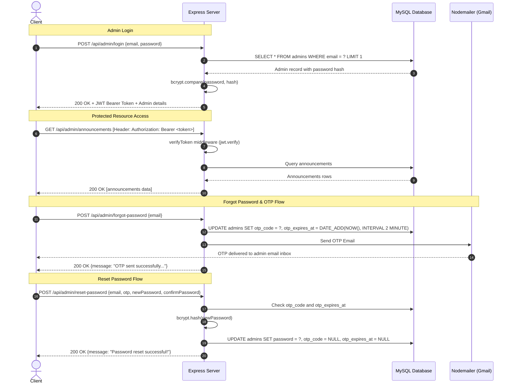

# Authentication & Authorization Architecture

This document outlines the security architecture, token generation, password hashing, and authentication workflows implemented in the Brito School Backend.

---

## 1. Overview & Security Standards

- **Token Format:** JSON Web Token (JWT)
- **Token Type:** Bearer Token via standard HTTP `Authorization` Header
- **Token Algorithm:** HMAC SHA-256 (`HS256`)
- **Default Lifespan:** `1d` (24 Hours)
- **Password Hashing:** `bcrypt` with automatic 10-round salt generation
- **OTP Generation:** Cryptographically random 6-digit numeric code
- **OTP Lifespan:** 2 minutes (timestamp computed natively via MySQL `DATE_ADD(NOW(), INTERVAL 2 MINUTE)`)

---

## 2. Authentication Flow



---

## 3. Token Verification Middleware (`verifyToken`)

All routes located under `/api/admin` (excluding `/login`, `/forgot-password`, `/reset-password`) are strictly protected by `verifyToken` located at `admin/middleware/authMiddleware.js`.

### Header Format
```http
Authorization: Bearer <JWT_TOKEN_HERE>
```

### Verification Logic:
1. Extracts `req.headers["authorization"]`.
2. Validates that the header starts with `"Bearer "`.
3. If header is missing or invalid format:
   ```json
   {
     "success": false,
     "message": "Unauthorized: No token provided"
   }
   ```
   **HTTP Status:** `401 Unauthorized`
4. Verifies signature using `process.env.JWT_SECRET`:
   ```javascript
   const decoded = jwt.verify(token, process.env.JWT_SECRET);
   req.admin = decoded; // { id, email, iat, exp }
   next();
   ```
5. If expired or signature invalid:
   ```json
   {
     "success": false,
     "message": "Unauthorized: Invalid or expired token"
   }
   ```
   **HTTP Status:** `401 Unauthorized`

---

## 4. Rate Limiting Protection

To prevent brute force credential stuffing, password cracking, and denial-of-service on email delivery, sliding-window rate limiters are applied:

| Endpoint Group | Window | Max Requests | Response Code | Headers Included |
| :--- | :--- | :--- | :--- | :--- |
| **Auth Endpoints** (`/login`, `/forgot-password`, `/reset-password`) | 15 minutes | 30 requests per IP | `429 Too Many Requests` | `X-RateLimit-Limit`, `X-RateLimit-Remaining`, `X-RateLimit-Reset`, `Retry-After` |
| **General APIs** (`/api/*`) | 15 minutes | 1,000 requests per IP | `429 Too Many Requests` | `X-RateLimit-Limit`, `X-RateLimit-Remaining`, `X-RateLimit-Reset`, `Retry-After` |

### 429 Error Response Example
```json
{
  "success": false,
  "message": "Too many authentication attempts. Please try again later.",
  "retryAfterSeconds": 845
}
```

---

## 5. Security Recommendations for Production
1. **Rotate `JWT_SECRET`**: Ensure a cryptographically strong 256-bit secret is placed in production `.env`.
2. **HTTPS Enforced**: Run Express behind an SSL/TLS terminating reverse proxy (Nginx, Cloudflare, AWS ALB) so tokens in `Authorization` headers are encrypted in transit.
3. **App Passwords for Nodemailer**: When using Gmail SMTP, generate a 16-character dedicated Google App Password.
