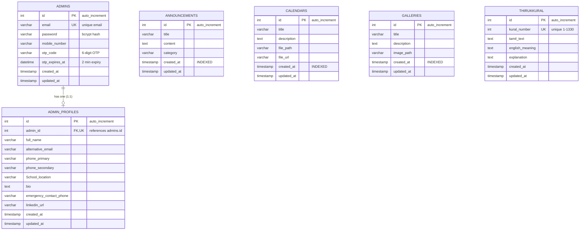

# Database Architecture & Optimization Guide

This document provides a comprehensive overview of the MySQL database architecture for the Brito School backend, including connection pooling, table schemas, relationships, performance indexes, and query execution plans.

---

## 1. MySQL Architecture & Connection Pool

The application utilizes `mysql2/promise` with an optimized connection pool configured in `config/db.js`.

### Connection Pool Configuration Parameters
| Parameter | Value | Purpose |
| :--- | :--- | :--- |
| `connectionLimit` | `20` (Configurable via `DB_CONNECTION_LIMIT`) | Maximum number of concurrent connections maintained |
| `maxIdle` | `10` | Maximum number of idle connections allowed in pool |
| `idleTimeout` | `60000` (60 seconds) | Idle connections beyond `maxIdle` are closed after 60s |
| `enableKeepAlive` | `true` | Sends periodic TCP keepalive probes to prevent silent dropouts |
| `keepAliveInitialDelay` | `10000` (10 seconds) | Interval before first keepalive packet is sent |
| `connectTimeout` | `10000` (10 seconds) | Fast failure detection if MySQL host is unreachable |
| `waitForConnections` | `true` | Requests wait for available connection rather than failing |
| `queueLimit` | `0` | Unlimited request queueing during sudden bursts |
| `charset` | `utf8mb4` | Full Unicode support including multilingual Tamil text and emojis |

---

## 2. Entity-Relationship Model



---

## 3. Detailed Table Dictionary

### 3.1 Table: `admins`
Stores administrator accounts, credentials, and password reset OTP states.

| Column | Type | Nullable | Key | Default | Description |
| :--- | :--- | :--- | :--- | :--- | :--- |
| `id` | `INT` | NO | PK | `AUTO_INCREMENT` | Unique Admin Identifier |
| `email` | `VARCHAR(255)` | NO | UNI | `NULL` | Admin Login Email (Unique) |
| `password` | `VARCHAR(255)` | NO | | `NULL` | Bcrypt Hashed Password |
| `mobile_number` | `VARCHAR(15)` | YES | | `NULL` | Contact Phone Number |
| `otp_code` | `VARCHAR(6)` | YES | | `NULL` | 6-digit Temporary Password Reset OTP |
| `otp_expires_at` | `DATETIME` | YES | | `NULL` | OTP Expiration Timestamp (NOW + 2 Min) |
| `created_at` | `TIMESTAMP` | YES | | `CURRENT_TIMESTAMP` | Account Creation Date |
| `updated_at` | `TIMESTAMP` | YES | | `CURRENT_TIMESTAMP ON UPDATE` | Last Profile / Password Update Date |

---

### 3.2 Table: `admin_profiles`
Stores extended personal and professional details for administrators. One-to-one relationship with `admins`.

| Column | Type | Nullable | Key | Default | Description |
| :--- | :--- | :--- | :--- | :--- | :--- |
| `id` | `INT` | NO | PK | `AUTO_INCREMENT` | Profile Record ID |
| `admin_id` | `INT` | NO | FK, UNI | `NULL` | Foreign Key referencing `admins.id` (`ON DELETE CASCADE`) |
| `full_name` | `VARCHAR(100)` | NO | | `NULL` | Administrator Full Name |
| `alternative_email` | `VARCHAR(100)` | NO | | `NULL` | Secondary Email Address |
| `phone_primary` | `VARCHAR(20)` | YES | | `NULL` | Primary Phone Number |
| `phone_secondary` | `VARCHAR(20)` | YES | | `NULL` | Alternative Contact Phone |
| `School_location` | `VARCHAR(255)` | YES | | `NULL` | Campus / School Location Branch |
| `bio` | `TEXT` | YES | | `NULL` | Biography / Role Overview |
| `emergency_contact_phone` | `VARCHAR(20)` | YES | | `NULL` | Emergency Contact Number |
| `linkedin_url` | `VARCHAR(255)` | YES | | `NULL` | LinkedIn Profile URL |
| `created_at` | `TIMESTAMP` | YES | | `CURRENT_TIMESTAMP` | Record Creation Timestamp |
| `updated_at` | `TIMESTAMP` | YES | | `CURRENT_TIMESTAMP ON UPDATE` | Last Record Update Timestamp |

---

### 3.3 Table: `announcements`
Stores institutional notifications and announcements.

| Column | Type | Nullable | Key | Default | Description |
| :--- | :--- | :--- | :--- | :--- | :--- |
| `id` | `INT` | NO | PK | `AUTO_INCREMENT` | Announcement ID |
| `title` | `VARCHAR(255)` | NO | | `NULL` | Announcement Heading |
| `content` | `TEXT` | NO | | `NULL` | Detailed Announcement Message Body |
| `category` | `VARCHAR(100)` | YES | | `'General'` | Category (e.g., General, Academic, Events) |
| `created_at` | `TIMESTAMP` | YES | MUL | `CURRENT_TIMESTAMP` | Publication Date (**Indexed for DESC sorting**) |
| `updated_at` | `TIMESTAMP` | YES | | `CURRENT_TIMESTAMP ON UPDATE` | Last Edit Date |

---

### 3.4 Table: `calendars`
Stores downloadable academic calendars and school schedules.

| Column | Type | Nullable | Key | Default | Description |
| :--- | :--- | :--- | :--- | :--- | :--- |
| `id` | `INT` | NO | PK | `AUTO_INCREMENT` | Calendar Record ID |
| `title` | `VARCHAR(255)` | NO | | `NULL` | Calendar Title / Year Description |
| `description` | `TEXT` | YES | | `NULL` | Additional Calendar Notes |
| `file_path` | `VARCHAR(255)` | NO | | `NULL` | Server Physical Relative Path |
| `file_url` | `VARCHAR(255)` | NO | | `NULL` | Static Public URL (`/uploads/calendars/...`) |
| `created_at` | `TIMESTAMP` | YES | MUL | `CURRENT_TIMESTAMP` | Upload Timestamp (**Indexed for DESC sorting**) |
| `updated_at` | `TIMESTAMP` | YES | | `CURRENT_TIMESTAMP ON UPDATE` | Last Update Date |

---

### 3.5 Table: `galleries`
Stores event photos and school media images.

| Column | Type | Nullable | Key | Default | Description |
| :--- | :--- | :--- | :--- | :--- | :--- |
| `id` | `INT` | NO | PK | `AUTO_INCREMENT` | Gallery Item ID |
| `title` | `VARCHAR(255)` | NO | | `NULL` | Image Title |
| `description` | `TEXT` | YES | | `NULL` | Image Description |
| `image_path` | `VARCHAR(255)` | NO | | `NULL` | Static Public URL (`/uploads/galleries/...`) |
| `created_at` | `TIMESTAMP` | YES | MUL | `CURRENT_TIMESTAMP` | Upload Timestamp (**Indexed for DESC sorting**) |
| `updated_at` | `TIMESTAMP` | YES | | `CURRENT_TIMESTAMP ON UPDATE` | Last Update Date |

---

### 3.6 Table: `thirukkural`
Stores classical Tamil Thirukkural verses, translations, and explanations.

| Column | Type | Nullable | Key | Default | Description |
| :--- | :--- | :--- | :--- | :--- | :--- |
| `id` | `INT` | NO | PK | `AUTO_INCREMENT` | Kural Database ID |
| `kural_number` | `INT` | NO | UNI | `NULL` | Kural Number (1 to 1330, Unique) |
| `tamil_text` | `TEXT` | NO | | `NULL` | Original Tamil Couplet |
| `english_meaning` | `TEXT` | NO | | `NULL` | English Translation |
| `explanation` | `TEXT` | YES | | `NULL` | Detailed Literary Explanation |
| `created_at` | `TIMESTAMP` | YES | | `CURRENT_TIMESTAMP` | Record Creation Timestamp |
| `updated_at` | `TIMESTAMP` | YES | | `CURRENT_TIMESTAMP ON UPDATE` | Last Update Date |

---

## 4. Performance Indexes & Query Optimization

### Applied Indexes:
```sql
-- Prevents full table scan and filesort on announcement listings
CREATE INDEX idx_announcements_created_at ON announcements (created_at DESC);

-- Prevents full table scan and filesort on calendar listings
CREATE INDEX idx_calendars_created_at ON calendars (created_at DESC);

-- Prevents full table scan and filesort on gallery listings
CREATE INDEX idx_galleries_created_at ON galleries (created_at DESC);
```

### EXPLAIN Execution Analysis:
Prior to index creation, all listing queries (`ORDER BY created_at DESC`) required full table scans (`type: ALL`) with an in-memory/disk `Using filesort`.

With the applied descending B-tree indexes:
- **Scan Type:** Index scan (`type: index` / `range`)
- **Key Used:** `idx_announcements_created_at`, `idx_calendars_created_at`, `idx_galleries_created_at`
- **Extra:** Eliminated `Using filesort` for scalable high-throughput retrieval.

---

## 5. API to Database Table Mapping

| API Endpoint | HTTP Method | Affected Database Table(s) | Operation |
| :--- | :--- | :--- | :--- |
| `/api/admin/login` | `POST` | `admins` | `SELECT` |
| `/api/admin/forgot-password` | `POST` | `admins` | `SELECT`, `UPDATE` |
| `/api/admin/reset-password` | `POST` | `admins` | `SELECT`, `UPDATE` |
| `/api/admin/announcements` | `GET` | `announcements` | `SELECT` |
| `/api/admin/announcements` | `POST` | `announcements` | `INSERT`, `SELECT` |
| `/api/admin/announcements` | `PUT` | `announcements` | `SELECT`, `UPDATE` |
| `/api/admin/announcements` | `DELETE` | `announcements` | `SELECT`, `DELETE` |
| `/api/admin/calendars` | `GET` | `calendars` | `SELECT` |
| `/api/admin/calendars` | `POST` | `calendars` | `INSERT`, `SELECT` |
| `/api/admin/calendars` | `DELETE` | `calendars` | `SELECT`, `DELETE` |
| `/api/admin/galleries` | `GET` | `galleries` | `SELECT` |
| `/api/admin/galleries` | `POST` | `galleries` | `INSERT`, `SELECT` |
| `/api/admin/galleries` | `PUT` | `galleries` | `SELECT`, `UPDATE` |
| `/api/admin/galleries` | `DELETE` | `galleries` | `SELECT`, `DELETE` |
| `/api/admin/thirukkural` | `GET` | `thirukkural` | `SELECT` |
| `/api/admin/thirukkural` | `POST` | `thirukkural` | `SELECT`, `INSERT` |
| `/api/admin/thirukkural` | `PUT` | `thirukkural` | `SELECT`, `UPDATE` |
| `/api/admin/thirukkural` | `DELETE` | `thirukkural` | `SELECT`, `DELETE` |
| `/api/admin/profile` | `GET` | `admin_profiles` | `SELECT` |
| `/api/admin/profile` | `POST` | `admin_profiles` | `SELECT`, `INSERT` |
| `/api/admin/profile` | `PUT` | `admin_profiles` | `SELECT`, `UPDATE` |
| `/api/admin/profile` | `DELETE` | `admin_profiles` | `SELECT`, `DELETE` |
